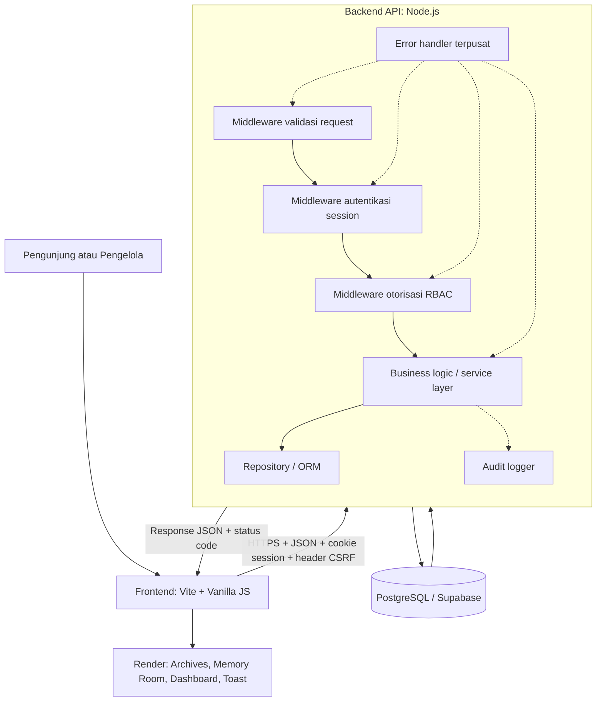
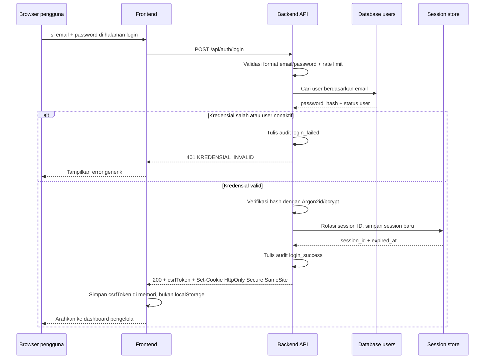
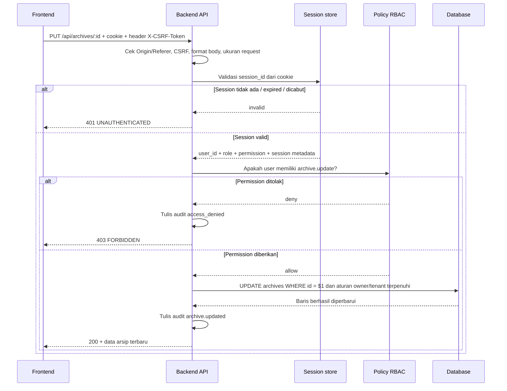
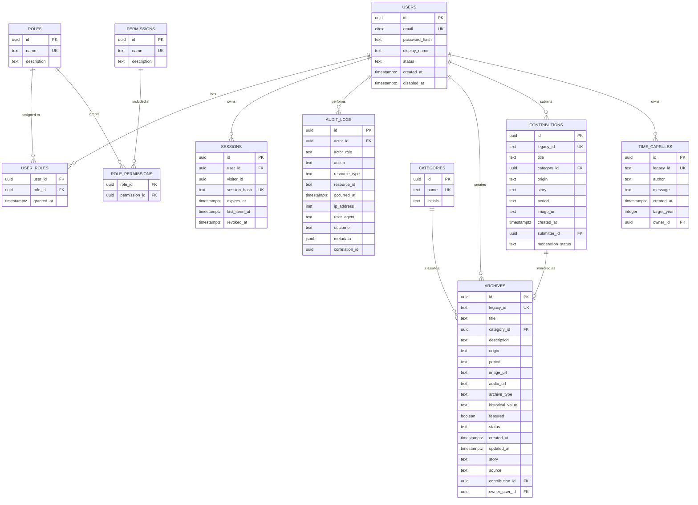

# ARCHITECTURE.md — Rencana Migrasi MUSEUM OF ALMOST

> **Dokumen perencanaan arsitektur — bukan implementasi.**
>
> | Field | Nilai |
> |---|---|
> | Nama proyek | MUSEUM OF ALMOST |
> | Dokumen ini | Rencana migrasi frontend-only → backend Node.js + PostgreSQL/Supabase |
> | Versi | 1.0 |
> | Tanggal | 19 November 2026 |
> | Status | **Rencana — belum diimplementasikan** |
> | Dokumen acuan | `SPEC.md`, `UI-SPEC.md`, `TASKS.md` (dibaca, tidak diubah) |
> | Ruang lingkup | Dokumentasi dan perencanaan saja |

---

## Panduan membaca dokumen ini

Dokumen ini sengaja memisahkan tiga hal yang sering tertukar:

| Penanda | Arti |
|---|---|
| **Kondisi saat ini** | Apa yang benar-benar sudah ada di kode proyek sekarang. |
| **Arsitektur target** | Rancangan sistem di masa depan. **Belum dibuat.** |
| **Akan diimplementasikan** | Fitur/pekerjaan yang baru akan dikerjakan pada tahap migrasi. |

Pada kondisi saat ini, **MUSEUM OF ALMOST tidak memiliki backend, database eksternal, autentikasi, login, sesi, RBAC, atau audit log**. Dashboard `#/admin` sengaja diberi label **MODE DEMO — tanpa login**. Jangan menganggap aplikasi saat ini sudah aman karena memiliki CRUD; CRUD tersebut hanya mengubah data di browser pengguna sendiri.

---

## 1. Ringkasan Eksekutif

MUSEUM OF ALMOST saat ini adalah SPA statis yang seluruh datanya disimpan di `localStorage`. Arsitektur ini sangat cocok untuk MVP satu hari: cepat, tanpa server, dan mudah dijalankan dengan `npm run dev`. Namun ia memiliki batasan fundamental: data hanya ada di satu perangkat, siapa pun yang membuka dashboard demo dapat mengubah data, tidak ada identitas pengguna, tidak ada jejak audit, dan tidak ada perlindungan server-side.

Rencana target adalah memindahkan database sebagai **sumber data utama** ke PostgreSQL atau Supabase, dengan lapisan backend Node.js yang bertugas melakukan validasi, autentikasi, otorisasi RBAC, logika bisnis, audit log, dan kontrol akses. Frontend tetap Vite + Vanilla JavaScript. Peran `store.js` berubah dari "penyimpan localStorage" menjadi **API client/adapter** dengan antarmuka yang sama sebisa mungkin, sehingga `ui.js` tidak perlu ditulis ulang besar-besaran.

Rekomendasi akhir: **Node.js (Express atau Fastify) + managed PostgreSQL + session cookie server-side dengan Argon2id** sebagai jalur utama, dengan Supabase Auth/Supabase Postgres sebagai alternatif jika prioritas tim adalah kecepatan pengembangan. Detail dan trade-off ada di Bab 12 dan 14.

---

## 2. Kondisi Sistem Saat Ini

### 2.1 Stack dan struktur aktual

Berdasarkan pemeriksaan langsung terhadap proyek:

```text
MuseumOfAlmost/
├── index.html              # shell: #site-header, #app, #site-footer, #toast-region
├── package.json            # hanya dependency vite
├── SPEC.md
├── UI-SPEC.md
├── TASKS.md
├── src/
│   ├── main.js             # entry point + hash router + bootstrap
│   ├── products.js         # konstanta, kategori, tipe arsip, seed, teks museum
│   ├── store.js            # satu-satunya jalan masuk ke localStorage
│   ├── ui.js               # semua view, render, event, modal, toast, form
│   └── style.css           # design system + seluruh gaya responsif
└── dist/                   # hasil build Vite
```

Karakteristik penting:

- **Frontend:** Vite + JavaScript Vanilla (ES modules), tanpa framework UI.
- **Routing:** hash router di `main.js` dengan 7 rute: `#/`, `#/archives`, `#/archive/:id`, `#/contribute`, `#/time-capsule`, `#/timeline`, `#/admin`.
- **Render:** `ui.js` membangun HTML melalui template string dan memasang event setelah render.
- **Data:** seluruh view memanggil `store.js`; tidak ada `fetch()`, `axios`, atau panggilan jaringan ke API.
- **Styling:** palet editorial charcoal/ivory/bronze sesuai `UI-SPEC.md`; tabel dashboard berubah menjadi kartu di mobile.
- **Dependency:** hanya Vite. Tidak ada library autentikasi, ORM, atau database.

### 2.2 Peran file saat ini

| File | Peran aktual | Status |
|---|---|---|
| `index.html` | Shell aplikasi, skip link, region toast, favicon inline SVG. | Sudah ada |
| `src/main.js` | Parse hash, render shell + view, atur `document.title`, fokus heading, scroll, panggil `seedIfEmpty()`, tampilkan notifikasi pemulihan data. | Sudah ada |
| `src/products.js` | `CATEGORIES`, `ARCHIVE_TYPES`, `CATEGORY_INITIALS`, `OPENING_QUESTION`, `TAGLINE`, `WHATSAPP_CONFIG`, `SEED_ARCHIVES` (8 arsip), dan data timeline. | Sudah ada |
| `src/store.js` | Satu-satunya akses ke `localStorage`: baca/tulis JSON, validasi struktur, pemulihan data rusak, CRUD arsip, kontribusi, kapsul, statistik, export/import/reset. | Sudah ada |
| `src/ui.js` | Semua tampilan dan interaksi: landing, galeri, detail, form kontribusi, kapsul, timeline, dashboard, modal, toast. Memanggil `store.*`, bukan API. | Sudah ada |
| `src/style.css` | Token warna/tipografi, layout, komponen, breakpoint desktop/tablet/mobile. | Sudah ada |

### 2.3 Penyimpanan lokal saat ini

| Key | Isi | Penggunaan |
|---|---|---|
| `museum-of-almost:archives:v1` | `Archive[]` | Sumber utama arsip publik dan dashboard. |
| `moa:contributions:v1` | `Contribution[]` | Kontribusi pengunjung; dipantulkan sebagai arsip bayangan. |
| `moa:capsules:v1` | `TimeCapsule[]` | Pesan Time Capsule. |
| `moa:version:v1` | string `"1"` | Penanda versi skema lokal. |
| `moa:archives:v1` | key lama | Hanya dipakai `store.js` untuk migrasi sekali ke key baru. |

Semua penulisan memakai `JSON.stringify()`, semua pembacaan memakai `JSON.parse()` di dalam `try/catch`. Data divalidasi sebelum dipakai. Jika data rusak (JSON invalid, bukan array, field hilang/tipe salah, ID duplikat), `store.js` memulihkan `SEED_ARCHIVES` dan `main.js` menampilkan toast:

> Data arsip sebelumnya rusak atau tidak valid. Data contoh bawaan telah dipulihkan.

Fitur Data Management di dashboard sudah menyediakan **Export Archives**, **Import Archives**, dan **Reset Demo Data**. Export menghasilkan `museum-of-almost-archives.json` berisi JSON array terindentasi. Import memvalidasi file terlebih dahulu dan meminta konfirmasi sebelum mengganti arsip. Reset hanya mengganti arsip; Contribution dan Time Capsule sengaja tidak dihapus.

### 2.4 Model data saat ini

Field utama `Archive` sesuai `SPEC.md` dan implementasi:

```text
id, title, category, description, origin, period,
imageUrl, audioUrl, archiveType, historicalValue,
featured, createdAt, updatedAt, story, source, contributionId
```

Enum penting:

- `CATEGORIES`: 6 kategori tetap.
- `ARCHIVE_TYPES`: 10 tipe arsip tetap.
- `source`: `seed | contribution | admin`.
- `archiveType` untuk kontribusi: `Kontribusi Pengunjung`.

Aturan menarik yang sudah berjalan:

- Edit arsip mempertahankan `id`, `createdAt`, `source`, dan `contributionId`; hanya menulis `updatedAt`.
- Menghapus arsip bayangan kontribusi **tidak** menghapus record `Contribution`.
- `imageUrl` hanya path relatif lokal atau data URL gambar; skema `javascript:`, `http(s):`, `ftp:` ditolak.
- `audioUrl` boleh `''`, `null`, atau data URL audio yang diizinkan.

### 2.5 Keterbatasan pendekatan frontend-only

| Area | Keterbatasan nyata saat ini |
|---|---|
| **Keamanan** | Siapa pun dapat membuka `#/admin` dan mengubah/menghapus arsip. Tidak ada verifikasi identitas. |
| **Integritas data** | `localStorage` dapat disunting lewat DevTools. Validasi frontend bisa dilewati sehingga bukan jaminan keamanan. |
| **Akses bersama** | Data tidak sinkron antarperangkat. Dua pengelola tidak bisa bekerja pada satu koleksi yang sama. |
| **Kontrol perubahan** | Tidak ada locked update/versioning; dua tab browser bisa saling menimpa (lost update). |
| **Identitas & pengelolaan pengguna** | Tidak ada user, role, atau permission. Tidak mungkin membedakan Visitor, Manager, dan Administrator. |
| **Akuntabilitas** | Tidak ada audit log. Tidak diketahui siapa mengubah apa dan kapan. |
| **Privasi & kepemilikan** | Kontribusi/kapsul hanya "milik browser ini"; tidak ada pemilik yang dikenal sistem. |
| **Ketersediaan** | Data hilang saat browser dibersihkan, perangkat rusak, atau storage penuh. |
| **Cadangan** | Export/import manual bukan backup otomatis; tidak ada PITR (point-in-time recovery). |
| **Skalabilitas** | Data URL gambar membesar dan cepat mendekati kuota localStorage. |
| **Proteksi API** | Tidak ada rate limiting, CORS, CSRF, WAF, atau HTTPS di level aplikasi karena memang belum ada API. |

Kesimpulan: arsitektur saat ini **tepat untuk MVP demo**, tetapi tidak cocok untuk pengelolaan museum bersama, data publik yang tepercaya, atau akuntabilitas administratif.

---

## 3. Arsitektur Target

### 3.1 Komponen dan tanggung jawab

| Komponen | Teknologi rencana | Tanggung jawab utama |
|---|---|---|
| **Frontend** | Vite + Vanilla JS (tetap) | Merender 7 rute, form, tabel, toast; memanggil REST API; menyimpan token CSRF di memori; tidak menyimpan token sesi di `localStorage`. |
| **API client** | `src/store.js` yang disesuaikan | Menggantikan akses `localStorage` dengan `fetch()`; menjaga antarmuka `getArchives()`, `addArchive()`, dll. agar `ui.js` tetap stabil. |
| **Backend API** | Node.js + Express atau Fastify | Routing REST, validasi request, autentikasi, otorisasi, logika bisnis, audit, error handling terpusat. |
| **Authentication** | Argon2id/bcrypt + server-side session | Verifikasi kredensial, membuat sesi, rotasi session ID, logout, expiration, pencabutan sesi. |
| **Authorization** | RBAC di backend | Memeriksa permission berdasarkan role dari sesi terverifikasi, bukan dari input frontend. |
| **Database** | PostgreSQL atau Supabase Postgres | Sumber data tunggal: arsip, kategori, kontribusi, kapsul, user, role, sesi, audit log. |
| **Object storage** | Lokal/ S3 / Supabase Storage (opsional) | Menyimpan file gambar/audio hasil upload; database hanya menyimpan URL/objek referensi. |
| **Audit logging** | Tabel `audit_logs` append-only | Mencatat login, logout, perubahan arsip, perubahan role, import/reset, dan aksi administratif. |
| **Infrastruktur** | HTTPS, env var, backup, monitoring | Melindungi transport, menyimpan rahasia di server, memantau error dan performa. |

### 3.2 Prinsip desain target

1. **Database adalah satu-satunya sumber kebenaran.** `localStorage` tidak lagi dipakai sebagai penyimpanan utama.
2. **Frontend tidak dipercaya.** Setiap request divalidasi ulang di backend.
3. **Deny by default.** Endpoint protected menolak akses sampai session dan permission lolos.
4. **Identitas berasal dari session server.** Backend tidak menerima `userId` dari body/query sebagai bukti kepemilikan.
5. **Audit untuk setiap perubahan penting.** Aksi gagal pun dicatat, terutama login gagal dan akses ditolak.
6. **Antarmuka `store.js` dipertahankan.** Migrasi UI diminimalisir dengan adapter API.
7. **Identitas museum tetap MUSEUM OF ALMOST.** Tidak ada perubahan nama, palet, atau narasi demo menjadi produk lain.

### 3.3 Diagram arsitektur target — alur request utama



Penjelasan alur sesuai permintaan:

1. Pengunjung/pengelola mengakses frontend MUSEUM OF ALMOST.
2. Frontend mengirim request ke backend API melalui HTTPS.
3. Backend memvalidasi format body, query, parameter, ukuran request, dan tipe data.
4. Untuk endpoint protected, backend memeriksa autentikasi dari cookie session.
5. Backend memeriksa permission role (RBAC).
6. Backend menjalankan business logic, misalnya membuat arsip bayangan dari kontribusi.
7. Backend mengakses PostgreSQL/Supabase melalui repository/ORM dengan query parametrized.
8. Database mengembalikan hasil.
9. Backend menulis audit log untuk aksi penting, lalu mengirim response JSON ke frontend.
10. Frontend memperbarui tampilan tanpa reload penuh.

### 3.4 Diagram alur autentikasi



### 3.5 Diagram alur otorisasi



---

## 4. Rancangan Autentikasi yang Aman

### 4.1 Kebutuhan autentikasi pada target

Autentikasi baru akan diimplementasikan pada **Tahap 4** migrasi. Kebutuhannya:

- Hanya pengelola museum yang dapat masuk ke area manajemen.
- Kredensial diverifikasi di backend, bukan di browser.
- Status login tidak hanya disimpan sebagai boolean di frontend.
- Token/sesi sensitif tidak disimpan di `localStorage`.
- Ses dapat diketahui masa berlakunya dan dapat dicabut.
- Administrator dapat mencabut sesi semua perangkat jika diperlukan.

### 4.2 Penyimpanan password

| Aturan | Rencana |
|---|---|
| Format tersimpan | `password_hash`, bukan password plaintext. |
| Algoritma utama | **Argon2id**. Baseline: memory ~19 MiB, iterasi 2, parallelism 1; sesuaikan setelah benchmark. |
| Alternatif | bcrypt dengan cost minimal 12, target waktu verifikasi ~100–250 ms per attempt. |
| Garam (salt) | Dikelola otomatis oleh library hashing; unik per user. |
| Log | Password, hash, dan token **dilarang** masuk log aplikasi maupun audit log. |
| Kebijakan | Minimal 12 karakter, tolak password yang bocor/umum, hindari aturan komposisi yang berbelit. |
| Verifikasi | `verify(password, password_hash)` di backend; pesan error generik agar tidak membocorkan apakah email terdaftar. |

### 4.3 Proses login, logout, expiration, dan revocation

**Login**

1. Frontend mengirim `POST /api/auth/login` berisi email dan password.
2. Backend memvalidasi format dan menerapkan rate limiting per IP + per email.
3. Backend mencari user, memeriksa status aktif, lalu memverifikasi hash.
4. Jika berhasil, backend membuat session ID baru (rotasi terhadap session fixation).
5. Backend mengirim cookie session dengan atribut aman (Bab 5) dan mengembalikan `csrfToken` di body response.
6. Frontend menyimpan `csrfToken` **di memori** dan mengirimkannya sebagai header pada request mutasi.

**Logout**

1. Frontend mengirim `POST /api/auth/logout` dengan cookie + CSRF token.
2. Backend menghapus baris session dari session store.
3. Backend mengirim `Set-Cookie` dengan `Max-Age=0` untuk menghapus cookie di browser.
4. Backend menulis audit `logout`.
5. Frontend menghapus state pengguna dan kembali ke halaman publik.

**Session expiration**

- Idle timeout: misalnya 30 menit tanpa request.
- Absolute timeout: misalnya 12 jam sejak login.
- Aktivitas sah memperbarui `last_seen_at`, tetapi tidak memperpanjang absolute timeout tanpa batas.
- Response 401 digunakan ketika sesi kedaluwarsa; frontend menampilkan pesan "Sesi berakhir, silakan masuk kembali".

**Pencabutan session**

- Logout mencabut session aktif.
- Administrator dapat mencabut semua session seorang user (`DELETE /api/admin/users/:id/sessions`).
- Perubahan role/penonaktifan user langsung membatalkan session yang ada atau memaksa evaluasi ulang permission pada setiap request.
- Simpan hash session ID di database, bukan session ID plaintext jika memungkinkan.

### 4.4 Opsi autentikasi dengan Supabase Auth

Jika proyek memakai Supabase Auth:

- Gunakan Email/Password, Magic Link, atau OAuth provider dari Supabase.
- Backend memverifikasi JWT Supabase menggunakan JWKS/public key, bukan mempercayai decode JWT di frontend.
- Tetap hindari menyimpan access token/refresh token di `localStorage`.
- Pilih salah satu:
  - backend membuat session sendiri setelah JWT terverifikasi, lalu memakai cookie HttpOnly; **atau**
  - memakai refresh token Supabase yang ditaruh di cookie HttpOnly oleh layer server/BFF.
- `service_role` key **hanya** ada di environment backend. Jangan pernah dikirim ke browser.
- `anon` key boleh dipakai di frontend, tetapi keamanan bergantung pada RLS yang benar.
- Audit khusus tetap ditulis di tabel `audit_logs` milik aplikasi karena audit administrator bukan sekadar log Auth.

Supabase Auth mengurangi pekerjaan hashing dan reset password, tetapi tidak menghapus kebutuhan RBAC, validasi backend, dan audit aplikasi.

---

## 5. Session Cookie

### 5.1 Atribut cookie yang direncanakan

| Atribut | Nilai rencana | Fungsi | Alasan |
|---|---|---|---|
| `HttpOnly` | aktif | JavaScript tidak bisa membaca cookie melalui `document.cookie`. | Mengurangi risiko pencurian sesi jika terjadi XSS. Ini bukan pengganti sanitasi XSS. |
| `Secure` | aktif | Cookie hanya dikirim lewat HTTPS. | Mencegah sesi terkirim melalui HTTP plaintext. |
| `SameSite` | `Lax` sebagai default; `Strict` jika tidak ada kebutuhan cross-site; `None` hanya jika benar-benar cross-site dan disertai `Secure`. | Membatasi pengiriman cookie pada request lintas situs. | Pertahanan dasar terhadap CSRF. |
| `Path` | `/` | Cookie tersedia untuk seluruh API. | Sesuai kebutuhan SPA. |
| `Max-Age` / `Expires` | idle + absolute timeout | Menentukan masa berlaku. | Mencegah sesi hidup selamanya. |
| `Domain` | domain aplikasi saja | Tidak memakai wildcard yang terlalu luas. | Mengurangi ruang penyalahgunaan subdomain. |
| Prefix | `__Host-` jika memungkinkan | Mengikat cookie ke host, path `/`, dan `Secure`. | Melindungi dari penimpaan cookie oleh subdomain. |

Contoh konseptual header (belum diimplementasikan):

```http
Set-Cookie: __Host-moa_session=<random-session-id>; Path=/; Secure; HttpOnly; SameSite=Lax; Max-Age=1800
```

### 5.2 Mekanisme session sisi server

```text
session_id (random, >= 256 bit)
  -> disimpan sebagai hash di tabel sessions / Redis
  -> berisi user_id, visitor_id, roles snapshot, expired_at, last_seen_at, ip, user_agent
  -> cookie browser hanya membawa session_id
```

Ketika request protected masuk:

1. Backend membaca cookie session.
2. Backend mencari hash session di store.
3. Backend memeriksa `expired_at`, status user, dan pencabutan.
4. Backend memuat role/permission terbaru dari database, bukan hanya dari snapshot lama.
5. Request dilanjutkan hanya jika session dan permission valid.

### 5.3 Perlindungan CSRF

Cookie saja **tidak cukup**. Rencana perlindungan:

- `SameSite=Lax` atau `Strict` sebagai lapisan pertama.
- CSRF token dikirim di body response login, disimpan di memori frontend, lalu dikirim pada header `X-CSRF-Token` untuk semua metode unsafe (`POST`, `PUT`, `PATCH`, `DELETE`).
- Backend membandingkan header CSRF dengan token yang tersimpan bersama session.
- Backend memeriksa `Origin`/`Referer` terhadap daftar origin yang diizinkan.
- Endpoint mutasi menolak `Content-Type` yang tidak diharapkan.
- Untuk skenario cross-site yang memang diperlukan, gunakan `SameSite=None; Secure` **dan** CSRF token; jangan mengandalkan SameSite saja.

### 5.4 Yang tidak boleh dilakukan

- Menyimpan session ID, JWT, atau refresh token di `localStorage` atau `sessionStorage`.
- Menaruh session di query string URL.
- Menganggap tombol yang disembunyikan di frontend sebagai authorization.
- Membuat "login palsu" di frontend tanpa verifikasi backend.
- Mengizinkan CORS wildcard `*` bersama request berkredensial.

---

## 6. Role-Based Access Control (RBAC)

### 6.1 Role yang direncanakan

| Role | Ringkasan |
|---|---|
| **Visitor** | Pengunjung museum. Dapat membaca arsip publik dan berpartisipasi terbatas. Untuk memiliki data privat, Visitor mendapat identitas server-issued: akun ringan atau guest session. |
| **Museum Manager** | Pengelola harian koleksi dan kontribusi. |
| **Administrator** | Pengelola akun, role, konfigurasi, dan audit log. |

### 6.2 Matriks permission

| Permission | Visitor | Museum Manager | Administrator | Catatan |
|---|:---:|:---:|:---:|---|
| `archive.read.public` | ✓ | ✓ | ✓ | Hanya arsip dengan status `published`. |
| `archive.read.draft` | — | ✓ (miliknya atau semua, sesuai kebijakan) | ✓ | Draft tidak boleh tampil di galeri publik. |
| `archive.create` | — | ✓ | ✓ | Manager membuat draft/arsip baru. |
| `archive.update` | — | ✓ | ✓ | Backend mempertahankan `id` dan `createdAt`. |
| `archive.delete` | — | ✓ | ✓ | Hapus arsip bayangan tidak menghapus `Contribution`. |
| `archive.feature` | — | ✓ | ✓ | Toggle status unggulan. |
| `archive.publish` | — | ✓ | ✓ | Perubahan status publikasi wajib diaudit. |
| `archive.export` | — | ✓ | ✓ | Export JSON arsip. |
| `archive.import` | — | terbatas | ✓ | Import mengganti data; sebaiknya butuh permission eksplisit. |
| `demo.reset` | — | — | ✓ | Reset demo hanya arsip, bukan contribution/capsule. |
| `contribution.create` | ✓ | ✓ | ✓ | Identitas pengirim berasal dari session. |
| `contribution.read.own` | ✓ | ✓ | ✓ | Visitor hanya melihat miliknya. |
| `contribution.read.any` | — | ✓ | ✓ | Untuk tab Contribution dashboard. |
| `contribution.moderate` | — | ✓ | ✓ | Menyetujui/menolak bila fitur moderasi ditambahkan. |
| `capsule.create` | ✓ | ✓ | ✓ | Pemilik dari session. |
| `capsule.read.own` | ✓ | ✓ | ✓ | Tidak boleh melihat kapsul orang lain. |
| `capsule.delete.own` | ✓ | ✓ | ✓ | Admin tetap tunduk pada aturan audit. |
| `user.manage` | — | — | ✓ | Buat/nonaktifkan akun pengelola. |
| `role.manage` | — | — | ✓ | Ubah role dan permission. |
| `audit.read` | — | — | ✓ | Akses log hanya Administrator. |
| `config.manage` | — | — | ✓ | Konfigurasi sistem museum. |

### 6.3 Aturan enforcement

- Backend memeriksa permission pada **setiap endpoint protected**, bukan hanya saat login.
- Role dan permission diambil dari database yang valid, bukan dari klaim yang dikirim frontend.
- Frontend boleh menyembunyikan tombol untuk UX, tetapi hal itu **bukan** pengamanan.
- Jika user memiliki beberapa role, backend menggabungkan permission lalu menerapkan aturan paling ketat untuk resource privat.
- Endpoint yang gagal otorisasi menghasilkan `403 FORBIDDEN` dan dicatat sebagai `access_denied`.
- Untuk resource privat milik orang lain, pertimbangkan `404 NOT_FOUND` agar keberadaan resource tidak bocor.

---

## 7. Isolasi Data Pemilik

### 7.1 Prinsip

Identitas pemilik selalu ditentukan oleh backend dari session yang sudah divalidasi:

```text
cookie session -> session store -> user_id / visitor_id -> owner filter pada query
```

Frontend **tidak boleh** mengirim `userId`, `ownerId`, atau `visitorId` lalu dipercaya begitu saja. Field tersebut, jika muncul di body request, harus diabaikan atau ditolak.

### 7.2 Penerapan per entitas

| Entitas | Aturan kepemilikan target |
|---|---|
| **Contribution** | `submitter_id` diisi dari `req.session.userId` atau `req.session.visitorId`. Visitor hanya dapat melihat/mengelola kontribusinya sendiri; Manager/Admin dapat melihat semua untuk keperluan kurasi. |
| **Time Capsule** | `owner_id` diisi dari session. Daftar kapsul difilter menurut pemilik. Kapsul orang lain tidak dikembalikan. |
| **Draft arsip** | `owner_user_id` diisi dari session Manager yang membuat. Manager lain hanya bisa mengubah jika memiliki permission `archive.update.any`. |
| **Arsip published** | Dapat dibaca publik selama `status = 'published'`. Tidak bergantung pada pemilik. |
| **Arsip hasil kontribusi** | Tetap memiliki `contribution_id` dan `source = 'contribution'`. Status awal `draft` atau `published` mengikuti kebijakan museum; jika langsung publik, tetap dicatat sebagai kontribusi. |
| **Audit log** | Bukan milik pengguna biasa. Hanya Administrator yang dapat membaca. |

### 7.3 Contoh aturan query konseptual

```sql
-- Visitor hanya melihat arsip publik dan arsip miliknya sendiri
SELECT *
FROM archives
WHERE status = 'published'
   OR owner_user_id = $1;

-- Visitor hanya melihat kapsul miliknya
SELECT *
FROM time_capsules
WHERE owner_id = $1;

-- Manager melihat semua kontribusi untuk keperluan kurasi
SELECT *
FROM contributions
ORDER BY created_at DESC;
```

Dengan Supabase, aturan yang sama dinyatakan sebagai kebijakan RLS. RLS adalah **lapisan pertahanan tambahan**, bukan pengganti pemeriksaan di backend.

---

## 8. Audit Log

### 8.1 Aktivitas yang wajib dicatat

| Aktivitas | Contoh `action` |
|---|---|
| Login berhasil | `auth.login_success` |
| Login gagal | `auth.login_failed` |
| Logout | `auth.logout` |
| Pembuatan arsip | `archive.created` |
| Perubahan arsip | `archive.updated` |
| Penghapusan arsip | `archive.deleted` |
| Perubahan status publikasi | `archive.published`, `archive.unpublished` |
| Perubahan status unggulan | `archive.featured` |
| Import/export arsip | `archive.imported`, `archive.exported` |
| Reset demo | `demo.reset` |
| Penambahan kontribusi | `contribution.created` |
| Perubahan role/permission | `role.updated`, `user.role_changed` |
| Pembuatan/nonaktifasi akun | `user.created`, `user.disabled` |
| Pencabutan sesi | `session.revoked` |
| Akses ditolak | `access.denied` |

### 8.2 Field audit log yang direncanakan

| Field | Keterangan |
|---|---|
| `id` | UUID unik. |
| `actor_id` | ID user/visitor yang melakukan aksi; null untuk sistem. |
| `actor_role` | Role saat aksi terjadi. |
| `action` | Jenis aktivitas dari daftar tetap. |
| `resource_type` | `archive`, `contribution`, `user`, dll. |
| `resource_id` | ID resource yang terpengaruh. |
| `occurred_at` | Waktu server dalam UTC. |
| `ip_address` | IP sumber, sudah dipertimbangkan sesuai kebijakan privasi. |
| `user_agent` | Informasi klien. |
| `outcome` | `success`, `failure`, `denied`. |
| `metadata` | JSONB berisi detail aman, misalnya field yang berubah. |
| `correlation_id` | Menghubungkan log dengan request ID. |
| `previous_hash` / `event_hash` | Opsi tamper-evidence dengan rantai hash. |

### 8.3 Prinsip audit log

- **Append-only:** aplikasi hanya diberi grant `INSERT` dan `SELECT`; tidak ada `UPDATE`/`DELETE` untuk role aplikasi biasa.
- **Tidak mudah dimanipulasi:** tabel dibatasi hanya untuk Administrator/service backend; opsi hash chain membuat perubahan terdeteksi.
- **Tidak menyimpan rahasia:** dilarang mencatat password, `password_hash`, session ID, cookie, token, atau data kartu.
- **Redaksi:** metadata difilter; field sensitif diganti `[REDACTED]`.
- **Akses terbatas:** hanya Administrator yang dapat membaca audit log via endpoint khusus.
- **Retensi:** misalnya 12 bulan online, lalu diarsipkan; kebijakan akhir mengikuti kebutuhan museum dan regulasi privasi.
- **Waktu server:** gunakan UTC dari server, bukan waktu yang dikirim klien.

---

## 9. Input Validation dan Keamanan API

### 9.1 Validasi input backend

Validasi frontend tetap dipertahankan untuk pengalaman pengguna, tetapi **tidak menggantikan validasi backend**. Semua endpoint akan memvalidasi:

| Aspek | Aturan rencana |
|---|---|
| Format body | JSON valid, `Content-Type: application/json`. Tolak body tanpa objek/array yang diharapkan. |
| Tipe data | Sama dengan aturan `validateArchive()` saat ini: string, boolean, tanggal ISO, dll. |
| Field wajib | `id`, `title`, `category`, `description`, `origin`, `period`, `imageUrl`, `audioUrl`, `archiveType`, `historicalValue`, `featured`, `createdAt`. |
| Enum | `category` harus salah satu `CATEGORIES`; `archiveType` harus salah satu `ARCHIVE_TYPES`; `source` sesuai enum. |
| Panjang teks | Misalnya title 1–100, description maks. 500, story 1–5000; sesuaikan dengan form. |
| ID | String tidak kosong; unik; format `arc_<hex>` untuk arsip baru; validasi UUID untuk user. |
| Tanggal | ISO 8601 yang dapat di-parse. |
| URL media | Path relatif lokal atau data URL dengan MIME diizinkan. Tolak `javascript:`, `http(s):`, `ftp:`, `//`, dan skema lain sesuai `SPEC.md`. |
| File upload | Batasi ukuran, tipe MIME, dan magic bytes; simpan ke object storage; jangan direct `innerHTML`. |
| Import JSON | Parse dalam `try/catch`, validasi seluruh array sebelum menulis, tolak ID duplikat. |
| Query | Filter/sort/page hanya dari daftar yang diizinkan; batasi `limit` maksimal. |

Library validator yang memungkinkan: Zod, Joi, atau express-validator. Pilih satu dan pakai skema yang sama untuk request dan response penting.

### 9.2 Proteksi terhadap ancaman umum

| Ancaman | Mitigasi rencana |
|---|---|
| SQL Injection | Query parametrized atau ORM. Tidak pernah menggabungkan input user ke string SQL. |
| XSS | Output encoding, `textContent`/`escapeHtml`, sanitasi bila ada rich text, CSP header, cookie HttpOnly. |
| CSRF | SameSite + CSRF token + Origin check pada semua request mutasi. |
| Brute force login | Rate limiting per IP dan email, exponential backoff, notifikasi admin, MFA untuk Administrator. |
| Session fixation | Rotasi session ID saat login dan perubahan privilege. |
| Request besar | Body limit JSON, upload limit, validasi ukuran file, streaming bila perlu. |
| CORS salah konfigurasi | Daftar origin eksplisit; `credentials: true` hanya untuk origin frontend production. |
| Man-in-the-middle | HTTPS/FTPS di semua lingkungan; HSTS pada production. |
| Error bocor | Error handler terpusat; response produksi hanya berisi kode error, pesan aman, dan `requestId`. Stack trace hanya di log server. |
| Mass assignment | Daftar field yang boleh diubah secara eksplisit; `id`, `createdAt`, `owner_id`, `role` tidak diambil dari payload biasa. |
| Import berbahaya | Validasi penuh, batas jumlah arsip, batas ukuran file, konfirmasi pengguna, audit. |

### 9.3 Bentuk error response terpusat

```json
{
  "error": {
    "code": "VALIDATION_FAILED",
    "message": "Periksa kembali data arsip.",
    "requestId": "req_01J...",
    "details": [
      { "field": "category", "message": "Kategori tidak dikenal." }
    ]
  }
}
```

Kode status yang direncanakan:

| Kode | Penggunaan |
|---|---|
| `400` | Validasi request gagal / format salah. |
| `401` | Tidak ada session atau session tidak valid. |
| `403` | Session valid tetapi permission tidak cukup. |
| `404` | Resource tidak ditemukan atau tidak boleh diketahui keberadaannya. |
| `409` | Konflik, misalnya ID duplikat atau versi data sudah berubah. |
| `413` | Payload/file terlalu besar. |
| `429` | Rate limit terlampaui. |
| `500` | Error server tak terduga; detail disembunyikan dari klien. |

### 9.4 Endpoint REST yang direncanakan

| Method | Endpoint | Permission | Keterangan |
|---|---|---|---|
| `POST` | `/api/auth/login` | publik | Login pengelola. |
| `POST` | `/api/auth/logout` | session | Logout dan cabut sesi. |
| `GET` | `/api/auth/me` | session | Info user dan permission saat ini. |
| `GET` | `/api/archives` | publik | Daftar arsip published, dengan filter/sort/pagination. |
| `GET` | `/api/archives/:id` | publik/protected | Detail arsip; draft hanya untuk yang berhak. |
| `POST` | `/api/archives` | `archive.create` | Tambah arsip. |
| `PATCH` | `/api/archives/:id` | `archive.update` | Edit arsip, mempertahankan `id`/`createdAt`. |
| `DELETE` | `/api/archives/:id` | `archive.delete` | Hapus arsip. |
| `PATCH` | `/api/archives/:id/featured` | `archive.feature` | Toggle unggulan. |
| `GET` | `/api/categories` | publik | Enum kategori dan tipe arsip. |
| `GET` | `/api/archives/export` | `archive.export` | Export JSON. |
| `POST` | `/api/archives/import` | `archive.import` | Import JSON setelah konfirmasi UI. |
| `POST` | `/api/contributions` | visitor | Kirim kontribusi + arsip bayangan. |
| `GET` | `/api/contributions` | `contribution.read.own/any` | Daftar kontribusi. |
| `POST` | `/api/capsules` | visitor | Buat kapsul. |
| `GET` | `/api/capsules` | `capsule.read.own` | Daftar kapsul milik sendiri. |
| `DELETE` | `/api/capsules/:id` | `capsule.delete.own` | Hapus kapsul sendiri. |
| `GET` | `/api/admin/stats` | `archive.read.*` | Statistik dashboard. |
| `GET` | `/api/admin/audit-logs` | `audit.read` | Audit log. |
| `POST` | `/api/admin/reset-demo` | `demo.reset` | Reset arsip ke seed; tidak menghapus contribution/capsule. |

---

## 10. Database dan Row Level Security

### 10.1 Diagram relasi awal



### 10.2 Penjelasan tabel penting

| Tabel | Fungsi dan catatan |
|---|---|
| `users` | Akun pengelola dan Visitor terdaftar. `password_hash` hanya dipakai jika autentikasi lokal; jika memakai Supabase Auth, tabel ini bisa menjadi profil yang tertaut ke `auth.users`. |
| `roles` | `visitor`, `museum_manager`, `administrator`. |
| `permissions` | Permission granular seperti `archive.update`, `audit.read`. |
| `user_roles` | Relasi many-to-many user–role. |
| `role_permissions` | Relasi many-to-many role–permission. |
| `sessions` | Session server-side. `session_hash` unik; `revoked_at` mendukung pencabutan. |
| `categories` | 6 kategori tetap dari `products.js`; di-seed ke database. |
| `archives` | Arsip. `status` (`draft`/`published`/`archived`) menggantikan ketergantungan pada `source` untuk menentukan visibilitas. `legacy_id` menjaga kompatibilitas dengan ID localStorage. |
| `contributions` | Kontribusi pengunjung dengan `submitter_id`. |
| `time_capsules` | Pesan dengan `owner_id`. |
| `audit_logs` | Catatan aktivitas append-only. |

### 10.3 Constraint dan index yang direncanakan

- Primary key UUID pada semua tabel utama.
- `UNIQUE` pada `users.email`, `roles.name`, `permissions.name`, `sessions.session_hash`, dan `legacy_id`.
- Foreign key dengan `ON DELETE RESTRICT` untuk data historis; `ON DELETE CASCADE` hanya untuk `user_roles`/`role_permissions` jika memang diinginkan.
- Check constraint:
  - `featured` boolean.
  - `status` masuk enum yang ditentukan.
  - `target_year` antara tahun berjalan dan +100.
  - `source` masuk enum.
- Index:
  - `archives(status, created_at DESC)` untuk galeri publik.
  - `archives(category_id, status)` untuk filter.
  - `archives(owner_user_id)` untuk draft.
  - `contributions(submitter_id, created_at DESC)`.
  - `time_capsules(owner_id, created_at DESC)`.
  - `audit_logs(occurred_at DESC)`, `audit_logs(actor_id, occurred_at DESC)`.
  - `sessions(expires_at)` untuk cleanup.

### 10.4 Row Level Security dengan Supabase

Jika memakai Supabase, RLS diaktifkan pada semua tabel yang berisi data pengguna. Kebijakan konseptual:

| Tabel | Kebijakan RLS yang direncanakan |
|---|---|
| `archives` | `SELECT` publik hanya untuk `status = 'published'`. Manager dapat membaca draft sesuai role claim. `INSERT`/`UPDATE`/`DELETE` hanya untuk role pengelola. |
| `contributions` | Visitor hanya `SELECT`/`INSERT` untuk baris dengan `submitter_id = auth.uid()`. Manager/Admin dapat `SELECT` semua. |
| `time_capsules` | Semua operasi Visitor dibatasi pada `owner_id = auth.uid()`. |
| `sessions` | Tidak boleh diakses langsung dari frontend. Hanya backend/service role. |
| `audit_logs` | `SELECT` hanya Administrator; `INSERT` hanya service role/backend. Tidak ada kebijakan `UPDATE`/`DELETE` untuk klien. |
| `users`, `roles`, `permissions`, join table | Hanya Administrator/service role yang dapat mengubah. |

Contoh kebijakan konseptual (bukan kode yang dipasang sekarang):

```sql
-- Arsip publik
CREATE POLICY archives_public_read
ON archives FOR SELECT
USING (status = 'published');

-- Kapsul hanya milik sendiri
CREATE POLICY capsules_owner_read
ON time_capsules FOR SELECT
USING (owner_id = auth.uid());

CREATE POLICY capsules_owner_delete
ON time_capsules FOR DELETE
USING (owner_id = auth.uid());
```

Ketentuan penting:

- Akses database tidak boleh mengandalkan validasi frontend.
- `anon` key di frontend tidak pernah diberi hak melewati RLS.
- `service_role` key **jangan pernah** diekspos ke browser; hanya di environment backend.
- RLS melengkapi pemeriksaan backend; backend tetap melakukan autentikasi, RBAC, validasi, dan audit.
- Kebijakan RLS harus diuji dengan tiga konteks: anonymous, authenticated visitor, dan manager/admin.

### 10.5 Perbedaan pendekatan

| Aspek | PostgreSQL + backend Node.js sendiri | Supabase |
|---|---|---|
| Kontrol logika bisnis | Penuh di backend aplikasi. | Bisa di backend aplikasi dan/atau RLS/Edge Functions. |
| Enforcement akses | Middleware + query backend. | RLS + policy + backend/API key. |
| Pengelolaan auth | Harus dibangun. | Disediakan Auth. |
| Audit aplikasi | Mudah dibuat eksplisit. | Perlu tetap dibuat sendiri; Auth log tidak cukup. |
| Operasional | Perlu backup, migrasi, pooling, patch. | Banyak diurus layanan. |
| Portabilitas | Tinggi jika memakai SQL standar. | Lebih terikat pada ekosistem Supabase jika banyak memakai fitur khusus. |

---

## 11. Rencana Migrasi localStorage ke Backend

Setiap tahap memiliki tujuan, pekerjaan utama, hasil, dan kriteria keberhasilan. Pekerjaan ini **belum dimulai**.

### Tahap 1 — Analisis Sistem

| Aspek | Isi |
|---|---|
| **Tujuan** | Memetakan seluruh data dan perilaku yang harus dipindahkan tanpa kehilangan fitur. |
| **Pekerjaan utama** | Inventarisasi key localStorage; dokumentasikan `Archive`, `Contribution`, `TimeCapsule`; petakan semua pemanggil `store.*` di `ui.js`; catat aturan CRUD, export/import, reset, dan kontribusi → arsip bayangan. |
| **Hasil diharapkan** | Dokumen pemetaan field, daftar endpoint kandidat, daftar risiko migrasi. |
| **Kriteria keberhasilan** | Setiap field di localStorage memiliki padanan target; setiap fungsi `store.*` memiliki rencana pengganti API; tidak ada fitur MVP yang hilang dari pemetaan. |

### Tahap 2 — Desain Database

| Aspek | Isi |
|---|---|
| **Tujuan** | Menetapkan skema yang konsisten, aman, dan mudah dimigrasi. |
| **Pekerjaan utama** | Finalisasi ERD; tentukan tipe kolom, constraint, enum, index, dan strategi `legacy_id`; siapkan migration tooling; tentukan policy RLS jika Supabase. |
| **Hasil diharapkan** | SQL migrasi awal, seed kategori, seed 8 arsip dari `products.js`, policy RLS draft. |
| **Kriteria keberhasilan** | Migrasi bisa dijalankan pada database kosong; seed valid; constraint menolak ID duplikat dan kategori invalid; policy RLS lolos pengujian dasar. |

### Tahap 3 — Pembangunan Backend

| Aspek | Isi |
|---|---|
| **Tujuan** | Membangun API dasar sebelum menyentuh UI. |
| **Pekerjaan utama** | Struktur proyek backend; route REST; skema validasi Zod/Joi; service & repository; error handler; pagination/filter; logging request ID; endpoint publik arsip. |
| **Hasil diharapkan** | API berjalan lokal dengan database development/staging; kontrak request/response terdokumentasi. |
| **Kriteria keberhasilan** | Endpoint publik mengembalikan 8 seed; input invalid ditolak dengan `400`; tidak ada SQL mentah tak terparametrisasi; error tidak membocorkan stack. |

### Tahap 4 — Autentikasi dan Authorization

| Aspek | Isi |
|---|---|
| **Tujuan** | Mengamankan area pengelolaan dan data privat. |
| **Pekerjaan utama** | Hash Argon2id/bcrypt; login/logout; session store; cookie HttpOnly/Secure/SameSite; CSRF; RBAC; isolasi `owner_id`; audit login dan akses ditolak. |
| **Hasil diharapkan** | Visitor, Manager, dan Administrator memiliki batas akses yang jelas. |
| **Kriteria keberhasilan** | Tanpa cookie → `401`; cookie valid tapi role salah → `403`; Visitor tidak bisa membaca kapsul/kontribusi orang lain; CSRF token salah ditolak; sesi kedaluwarsa dan dicabut berfungsi. |

### Tahap 5 — Migrasi Data

| Aspek | Isi |
|---|---|
| **Tujuan** | Memindahkan data lama dengan aman dan dapat dibatalkan. |
| **Pekerjaan utama** | Export arsip dari browser memakai fitur yang sudah ada; validasi dengan aturan `validateArchives`; seed dari `products.js`; upsert berdasarkan `legacy_id`; migrasi contribution/capsule hanya dengan persetujuan pengguna; backup sebelum migrasi; siapkan script rollback. |
| **Hasil diharapkan** | Database berisi arsip, kontribusi, dan kapsul yang valid tanpa duplikasi. |
| **Kriteria keberhasilan** | Jumlah data sesuai inventaris Tahap 1; tidak ada ID duplikat; checksum/count cocok; rollback terbukti bisa mengembalikan kondisi sebelum migrasi; seed tidak menimpa data hasil import. |

### Tahap 6 — Integrasi Frontend

| Aspek | Isi |
|---|---|
| **Tujuan** | Mengganti sumber data `store.js` tanpa merombak seluruh UI. |
| **Pekerjaan utama** | Ubah `store.js` menjadi API client; pertahankan nama fungsi; tambahkan state loading/error/empty; sesuaikan CRUD dashboard, export/import, dan reset; hapus akses `localStorage` sebagai sumber utama. |
| **Hasil diharapkan** | Galeri, Memory Room, landing, dan dashboard membaca database melalui API. |
| **Kriteria keberhasilan** | 7 rute tetap berfungsi; tambah/edit/hapus/toggle/refetch langsung tampil; error API menampilkan toast, bukan halaman kosong; tidak ada token di `localStorage`. |

### Tahap 7 — Audit dan Keamanan

| Aspek | Isi |
|---|---|
| **Tujuan** | Memverifikasi pertahanan berlapis sebelum produksi. |
| **Pekerjaan utama** | Aktifkan audit untuk semua aksi penting; uji permission tiap endpoint; uji isolasi pemilik; uji RLS; uji CSRF, XSS, rate limit, upload; tinjau dependency dan header keamanan. |
| **Hasil diharapkan** | Laporan pengujian keamanan dan daftar perbaikan. |
| **Kriteria keberhasilan** | Tidak ada endpoint protected yang bisa diakses tanpa session/permission; audit log mencatat skenario uji; XSS/CSRF tidak berhasil; tidak ada rahasia di log atau frontend bundle. |

### Tahap 8 — Deployment

| Aspek | Isi |
|---|---|
| **Tujuan** | Menjalankan sistem secara andal di production. |
| **Pekerjaan utama** | Environment variable; HTTPS/HSTS; database production; backup otomatis + PITR; health check; monitoring error/latensi; migrasi final dengan maintenance window singkat; dokumentasi operasional. |
| **Hasil diharapkan** | Aplikasi production dengan backend dan database aktif. |
| **Kriteria keberhasilan** | `npm run build` sukses; health check hijau; backup restore teruji; seluruh kriteria penerimaan `SPEC.md`/`UI-SPEC.md` masih lulus; rollback teruji. |

### 11.1 Strategi penggelaran bertahap

- Gunakan feature flag `DATA_SOURCE=local|api` saat transisi.
- Mulai dengan **read path**: galeri dan landing membaca API, tulis masih lokal; lalu aktifkan write path.
- Simpan adapter lokal sebagai fallback sementara hanya jika disetujui, dengan label jelas bahwa mode fallback bersifat sementara.
- Lakukan cutover pada satu lingkungan/staging sebelum production.
- Pastikan reset demo versi backend tetap tidak menghapus Contribution dan Time Capsule, sesuai perilaku saat ini.

---

## 12. Perbandingan PostgreSQL dan Supabase

| Aspek | PostgreSQL + Node.js sendiri | Supabase |
|---|---|---|
| **Kemudahan implementasi** | Perlu membangun struktur backend, auth, dan audit dari awal. | Lebih cepat karena Auth, Storage, PostgREST, dan dashboard database tersedia. |
| **Kontrol backend** | Paling penuh; logika bisnis dan kebijakan mudah dibaca di satu codebase. | Baik, tetapi logika bisa terbagi antara backend, RLS, dan Edge Functions. |
| **Pengelolaan autentikasi** | Harus implement hashing, session, reset password, MFA. | Disprovidekan; tinggal mengonfigurasi provider. |
| **Session management** | Server-side session sepenuhnya dikendalikan tim. | Bisa memakai Supabase session/JWT atau membuat session sendiri via BFF. |
| **Pengelolaan database** | Perlu migration, backup, pooling, monitoring sendiri, kecuali memakai managed Postgres. | Backup, dashboard, SQL editor, dan realtime lebih siap pakai. |
| **Dukungan RLS** | PostgreSQL native mendukung RLS, tapi harus ditulis dan diuji manual. | RLS adalah fitur inti dengan helper `auth.uid()` dan kebijakan dari dashboard/SQL. |
| **Skalabilitas** | Fleksibel; tergantung desain dan infrastruktur. | Mudah scale dengan layanan terkelola, tetapi mengikuti batas paket. |
| **Biaya** | Biaya server + database; bisa lebih murah jika sudah punya infra. | Freemium lalu berbayang sesuai usage; biaya lebih mudah diprediksi di awal. |
| **Ketergantungan layanan** | Rendah; mudah pindah host jika memakai SQL standar. | Lebih tinggi pada ekosistem Supabase. |
| **Maintenance** | Lebih banyak tanggung jawab tim: patch, backup, secret rotation. |Sebagian besar diurus penyedia. |
| **Cocok untuk proyek ini** | Sangat cocok karena kebutuhan audit, RBAC, dan kontrol eksplisit tinggi. | Cocok jika tim ingin rilis lebih cepat dan siap belajar RLS mendalam. |

### 12.1 Rekomendasi akhir

Rekomendasi utama:

> **Frontend Vite + Vanilla JS tetap dipertahankan; tambahkan backend Node.js (Express atau Fastify) dengan managed PostgreSQL; gunakan Argon2id + server-side session cookie; terapkan RBAC dan audit log di backend.**

Alasan:

1. Kebutuhan audit log dan RBAC lebih transparan jika berada di backend aplikasi.
2. Antarmuka `store.js` bisa dipertahankan sehingga perubahan UI relatif kecil.
3. Aturan import/reset yang sudah ada bisa dipindahkan ke endpoint dengan konfirmasi dan audit yang jelas.
4. Managed PostgreSQL mengurangi beban operasional tanpa mengorbankan portabilitas SQL.
5. Tim tetap bisa menambahkan Supabase Storage atau Supabase Auth kemudian jika diperlukan.

Trade-off: lebih banyak kode backend dan tanggung jawab operasional dibanding Supabase penuh. Mitigasinya: API surface sengaja dibatasi, gunakan validator skema tunggal, templat error tunggal, dan automation migration sejak awal.

Alternatif yang beralasan jika prioritas kecepatan:

> Supabase Postgres + Supabase Auth + RLS, dengan backend tipis hanya untuk audit dan operasi khusus.

Jika alternatif ini dipilih, tetap berlaku: service role server-only, RLS diuji menyeluruh, dan tidak ada klaim bahwa RLS saja cukup untuk seluruh authorization.

---

## 13. Risiko dan Mitigasi

| Risiko | Dampak | Mitigasi |
|---|---|---|
| Data hilang saat migrasi | Arsip/kontribusi tidak masuk database. | Export backup, dry run, hitung checksum/jumlah, simpan snapshot, siapkan script rollback. |
| ID duplikat | Import gagal atau data tertimpa. | Unique constraint `legacy_id`, upsert deterministik, validasi sebelum insert. |
| Validasi frontend dilewati | Data invalid masuk database. | Validasi backend dengan skema eksplisit; frontend hanya UX. |
| Session dicuri lewat XSS | Akun pengelola disalahgunakan. | HttpOnly + Secure + SameSite, CSP, output encoding, sanitasi, tidak menyimpan token di localStorage. |
| CSRF pada endpoint mutasi | Perubahan tanpa persetujuan pengguna. | CSRF token, Origin check, SameSite; jangan mengandalkan cookie saja. |
| RLS Supabase salah | Data privat bocor. | Uji policy untuk anonymous/visitor/manager/service role; deny by default; audit akses. |
| Service role bocor | Attacker mendapat akses penuh database. | Simpan hanya di secret manager/backend env; jangan pernah di bundle frontend; rotasi jika tersangka bocor. |
| Manager melebihi wewenang | Arsip atau data pengguna diubah tidak semestinya. | Permission granular, backend check tiap request, audit, tinjauan role berkala. |
| Audit log dimanipulasi | Jejak aktivitas tidak tepercaya. | Append-only grants, akses hanya Administrator, hash chain, backup terpisah. |
| Upload file berbahaya | Malware/penyimpanan membengkak. | Validasi MIME + magic bytes, batas ukuran, object storage terpisah, pemindaian bila tersedia. |
| MITM | Kredensial/sesi terbaca. | HTTPS + HSTS di semua environment. |
| Lost update | Edit terakhir menimpa edit sebelumnya. | Kolom `version`/`updated_at`, optimistic concurrency, response `409` saat konflik. |
| Downtime cutover | Pengguna tidak bisa mengakses museum. | Feature flag, staging, maintenance window, adapter fallback sementara, rollback teruji. |
| Vendor lock-in Supabase | Sulit pindah penyedia. | Simpan skema SQL portabel, batasi fungsi khusus, dokumentasikan dependensi Supabase. |
| Biaya tak terduga | Tagihan naik saat traffic/file besar. | Quota, monitoring, kompresi gambar, lifecycle storage, alert biaya. |

---

## 14. Status Fitur: Saat Ini vs Rencana

| Fitur | Kondisi saat ini | Status rencana |
|---|---|---|
| Vite + Vanilla JS | Sudah ada | Dipertahankan |
| Hash routing 7 rute | Sudah ada | Dipertahankan |
| `store.js` sebagai single source of truth | Sudah ada, berbasis localStorage | Diubah menjadi API client |
| CRUD arsip dashboard | Sudah ada, lokal | Dipindahkan ke REST API |
| Validasi arsip | Sudah ada di frontend/store | Ditambahkan validasi backend |
| Pemulihan data rusak | Sudah ada untuk localStorage | Digantikan migrasi + backup database saat cutover |
| Export/Import JSON | Sudah ada | Dipindahkan ke endpoint dengan audit |
| Reset Demo Data | Sudah ada, hanya arsip | Dipertahankan sebagai endpoint admin |
| Contribution & Time Capsule | Sudah ada, lokal | Dipindahkan ke tabel dengan `owner_id`/`submitter_id` |
| Backend Node.js | **Belum ada** | Tahap 3 |
| PostgreSQL/Supabase | **Belum ada** | Tahap 2–3 |
| Autentikasi & login | **Belum ada** | Tahap 4 |
| Session cookie aman | **Belum ada** | Tahap 4–5 |
| RBAC | **Belum ada** | Tahap 4 |
| Isolasi data pemilik | **Belum ada** | Tahap 4 |
| Audit log | **Belum ada** | Tahap 7 |
| HTTPS & deployment backend | **Belum ada** | Tahap 8 |

---

## 15. Kesimpulan

Arsitektur saat ini berhasil dan sengaja sederhana: satu halaman statis, satu modul data, satu dashboard demo. Keterbatasannya bukan bug implementasi, melainkan konsekuensi desain frontend-only.

Migrasi yang diusulkan tidak menghapus identitas MUSEUM OF ALMOST. Ia hanya memindahkan "tempat penyimpanan kebenaran" dari browser ke database, lalu menambahkan lapisan backend untuk menjaga keamanan, integritas, dan akuntabilitas. Dengan mempertahankan antarmuka `store.js`, sebagian besar kode UI dapat tetap digunakan, sehingga risiko perubahan bisa ditekan.

Dokumen ini adalah **rencana**. Tidak ada backend, database, login, session, RBAC, atau audit log yang dibuat pada tahap ini.

---

## 16. Batasan Pengerjaan Dokumen Ini

- Hanya membuat `ARCHITECTURE.md`.
- Tidak mengimplementasikan backend Node.js.
- Tidak membuat database atau migrasi SQL aktual.
- Tidak membuat halaman login palsu.
- Tidak menambahkan password, token, atau session palsu ke frontend.
- Tidak mengubah `src/`, `index.html`, `package.json`, atau file aplikasi lain.
- Tidak mengubah `SPEC.md`, `UI-SPEC.md`, dan `TASKS.md`.
- Tidak menambahkan dependency.
- Tidak menyatakan aplikasi saat ini sudah memiliki autentikasi, RBAC, atau keamanan server-side.
